# ARCHITECTURE — producer-consumer

> Progetto: producer-consumer · Data: 2026-11-23 · Versione: 1.0 · Stato: reviewed
> Documenti: [PRD](PRD.md) · [BEHAVIOR](BEHAVIOR.md) · [DESIGN-PATTERNS](DESIGN-PATTERNS.md) · [DESIGN-IN-THE-SMALL](DESIGN-IN-THE-SMALL.md) · [TEST-STRATEGY](TEST-STRATEGY.md) · [ANALYSIS](ANALYSIS.md) · [ADR](ADR/ADR-0001-stack.md) · [DESIGN-STATUS](DESIGN-STATUS.md)

Documento ricostruito dal codice in `src/main/java/producerconsumer` (reverse-engineering). Le
decisioni D1–D17 di `docs/design.md` sono citate tramite gli ADR. Il comportamento dinamico
(sequence, state, activity) è in [BEHAVIOR](BEHAVIOR.md).

## 1. Vista C4

### 1.1 Context

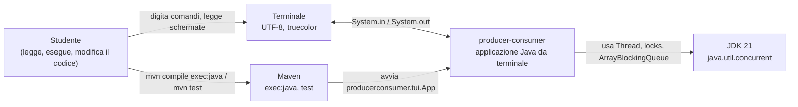

### 1.2 Container

Un solo container: un processo JVM, un solo modulo Maven, nessuna dipendenza runtime
([ADR-0001](ADR/ADR-0001-stack.md)). La vista utile è quella dei thread a runtime:

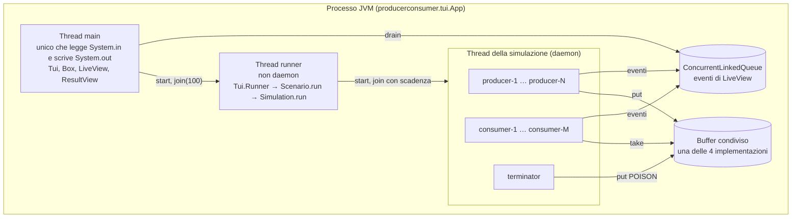

Il thread del run sequenziale è lo stesso `runner`: `SequentialScenario` non avvia altri thread.

### 1.3 Component: package e dipendenze

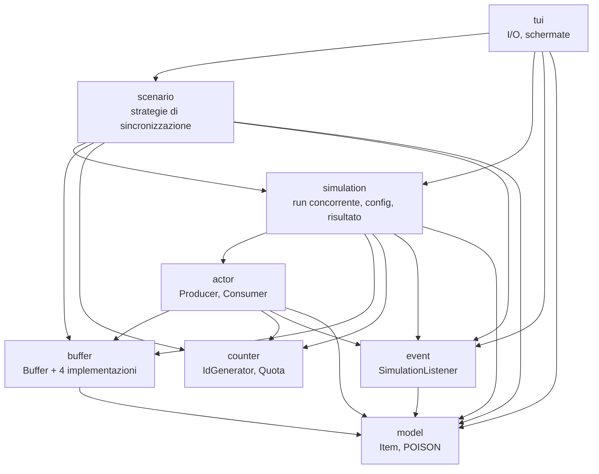

Le frecce sono gli `import` reali (verificati sul sorgente); il grafo è aciclico. Ordine topologico:
`model` → (`buffer`, `counter`, `event`) → `actor` → `simulation` → `scenario` → `tui`.
Il diagramma in `docs/GUIDE.md` §4 omette gli archi `scenario → buffer/counter/event/model`,
usati da `SequentialScenario`: divergenza minore (vedi [ANALYSIS](ANALYSIS.md), §5).

`event` è separato da `simulation` perché `actor` (che notifica) e `simulation` (che lo passa agli attori)
non devono formare un ciclo ([ADR-0013](ADR/ADR-0013-osservazione-eventi.md)).

## 2. Class diagram per package

Notazione: `+` pubblico, `-` privato, `~` package-private, `$` statico. Sono mostrati solo i membri rilevanti.

### 2.1 `model`

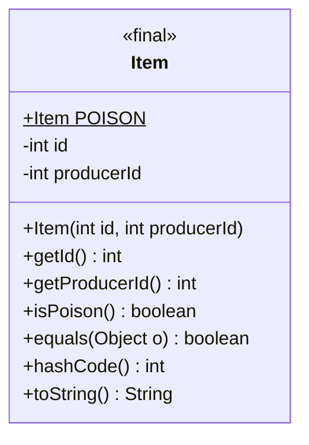

### 2.2 `counter`

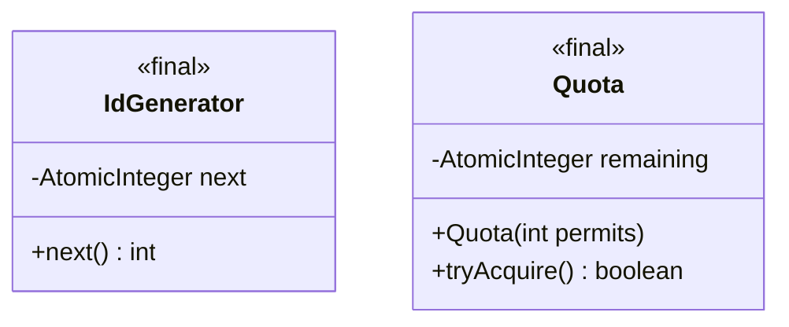

### 2.3 `buffer`

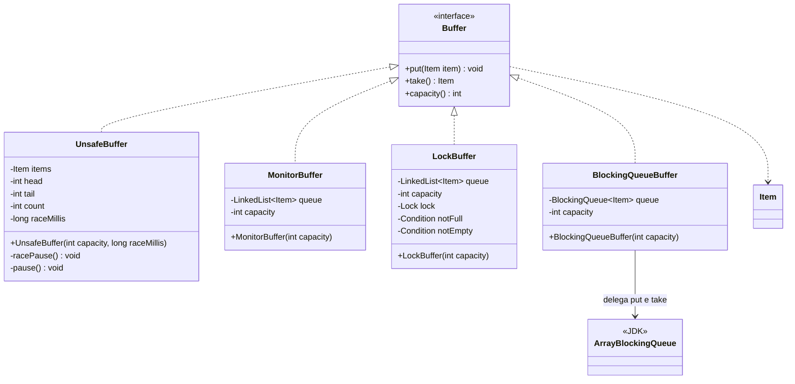

### 2.4 `event`

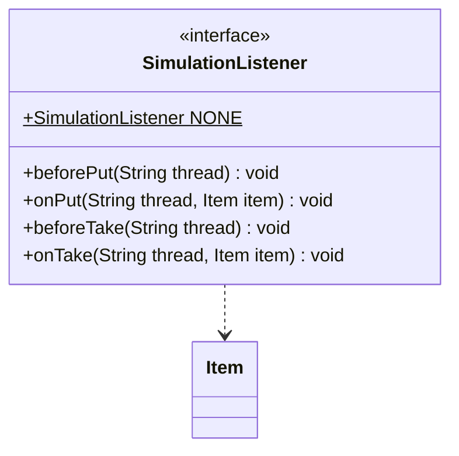

### 2.5 `actor`

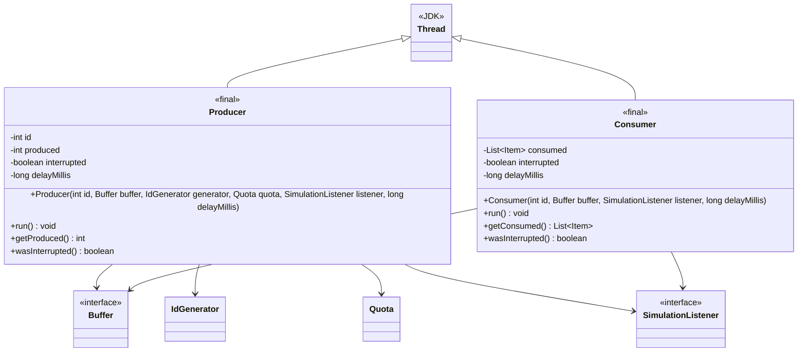

### 2.6 `simulation`

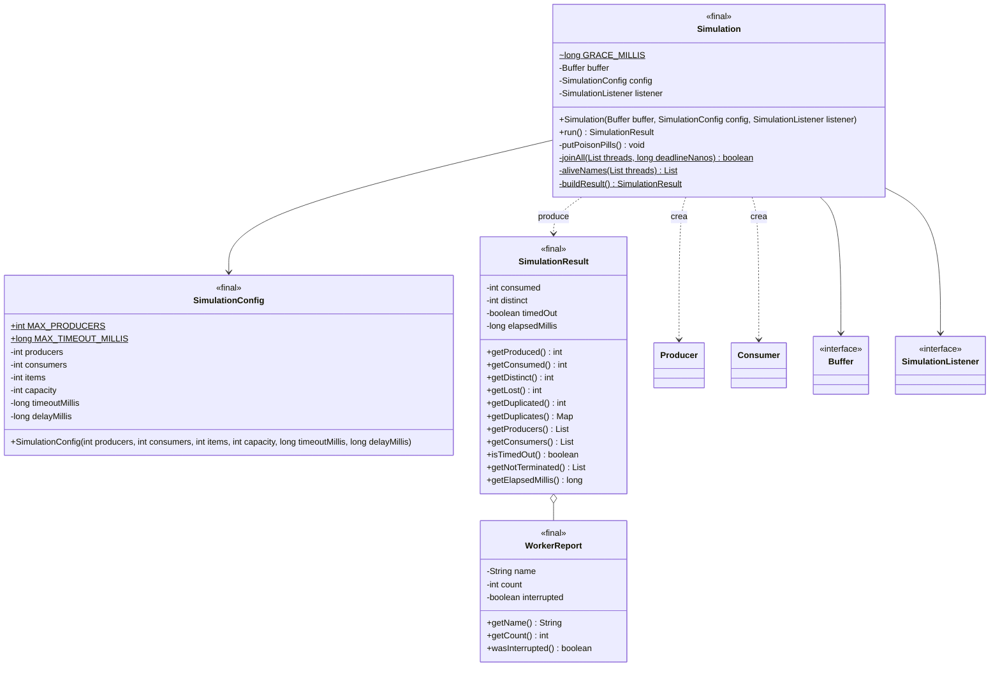

### 2.6 bis Costanti di `SimulationConfig`

| Costante | Min | Max |
|---|---|---|
| producers | `MIN_PRODUCERS` = 1 | `MAX_PRODUCERS` = 50 |
| consumers | `MIN_CONSUMERS` = 1 | `MAX_CONSUMERS` = 50 |
| items | `MIN_ITEMS` = 0 | `MAX_ITEMS` = 1.000.000 |
| capacity | `MIN_CAPACITY` = 1 | `MAX_CAPACITY` = 1.000 |
| timeoutMillis | `MIN_TIMEOUT_MILLIS` = 100 | `MAX_TIMEOUT_MILLIS` = 60.000 |
| delayMillis | `MIN_DELAY_MILLIS` = 0 | `MAX_DELAY_MILLIS` = 2.000 |

### 2.7 `scenario`

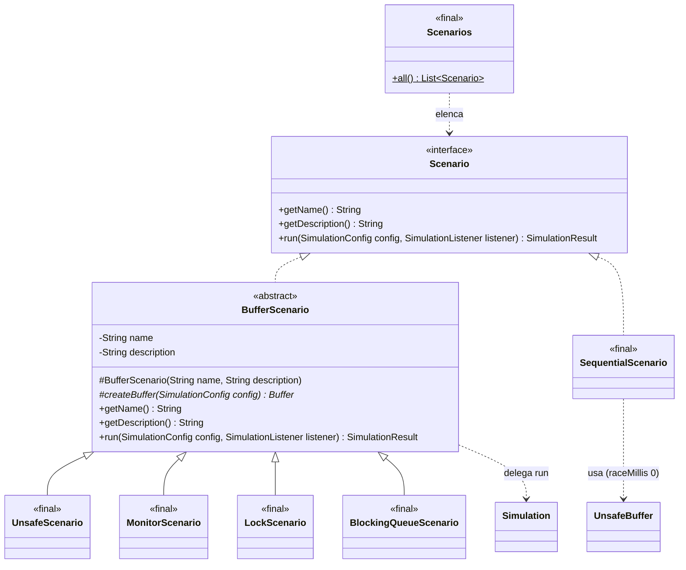

`run`, `getName` e `getDescription` di `BufferScenario` sono `final`. Le sottoclassi creano rispettivamente
`UnsafeBuffer(capacity, delayMillis)`, `MonitorBuffer`, `LockBuffer`, `BlockingQueueBuffer`.

### 2.8 `tui`

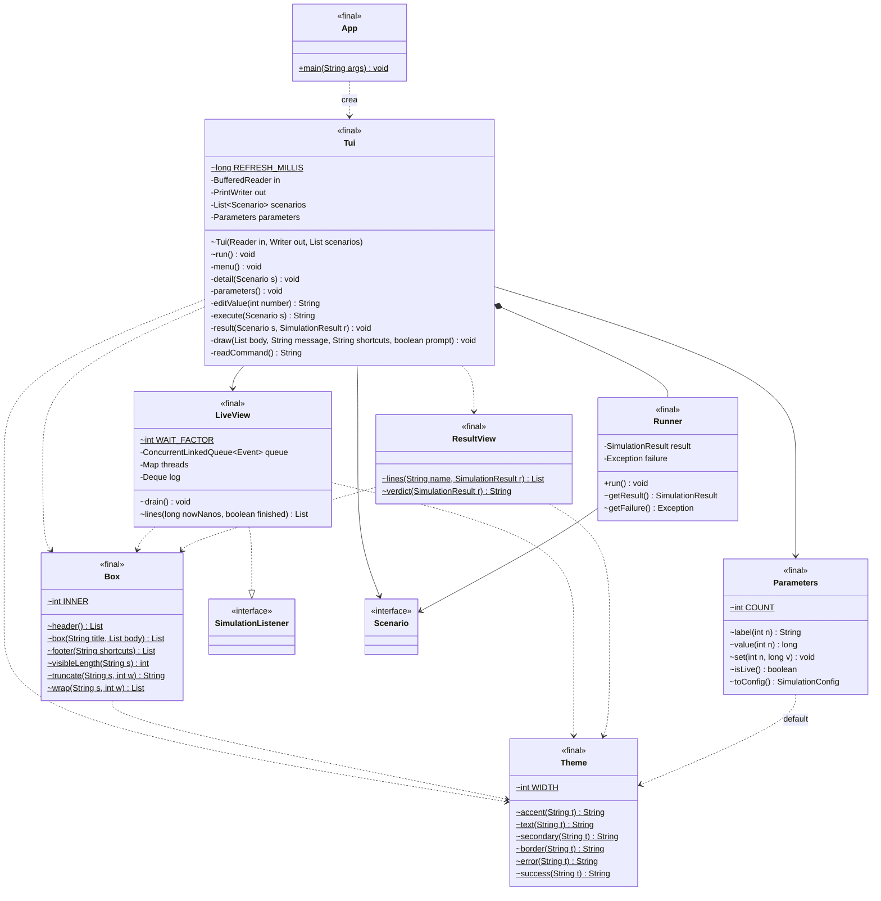

Tutte le classi di `tui` tranne `App` sono package-private.

### 2.9 Class diagram complessivo

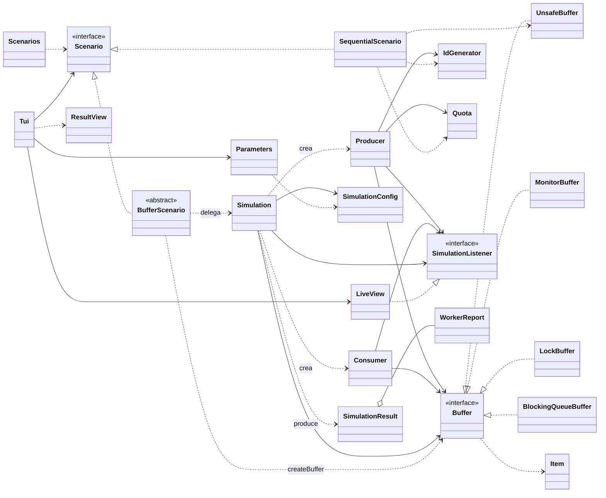

Le quattro sottoclassi di `BufferScenario` sono omesse per leggibilità (vedi §2.7).

## 3. Moduli: responsabilità, interfaccia pubblica, dipendenze

Ogni responsabilità è una sola frase. Le dipendenze elencano solo classi del progetto.

### 3.1 `model`

| Classe | Responsabilità singola | Interfaccia pubblica | Dipendenze |
|---|---|---|---|
| `Item` | Rappresentare un elemento scambiato, immutabile | `Item(int,int)`, `getId`, `getProducerId`, `isPoison`, `POISON`, `equals`, `hashCode`, `toString` | nessuna |

### 3.2 `counter`

| Classe | Responsabilità singola | Interfaccia pubblica | Dipendenze |
|---|---|---|---|
| `IdGenerator` | Fornire id unici in modo atomico | `int next()` | nessuna |
| `Quota` | Concedere un numero finito di permessi in modo atomico | `Quota(int)`, `boolean tryAcquire()` | nessuna |

### 3.3 `buffer`

| Classe | Responsabilità singola | Interfaccia pubblica | Dipendenze |
|---|---|---|---|
| `Buffer` | Definire il contratto di un buffer limitato | `put`, `take`, `capacity` | `Item` |
| `UnsafeBuffer` | Offrire un buffer senza mutua esclusione, con race riproducibile | `Buffer` + `UnsafeBuffer(int,long)` | `Item` |
| `MonitorBuffer` | Offrire un buffer con monitor intrinseco | `Buffer` + `MonitorBuffer(int)` | `Item` |
| `LockBuffer` | Offrire un buffer con `ReentrantLock` | `Buffer` + `LockBuffer(int)` | `Item` |
| `BlockingQueueBuffer` | Adattare `ArrayBlockingQueue` al contratto `Buffer` | `Buffer` + `BlockingQueueBuffer(int)` | `Item` |

### 3.4 `event`

| Classe | Responsabilità singola | Interfaccia pubblica | Dipendenze |
|---|---|---|---|
| `SimulationListener` | Notificare le operazioni sul buffer | `beforePut`, `onPut`, `beforeTake`, `onTake`, `NONE` | `Item` |

### 3.5 `actor`

| Classe | Responsabilità singola | Interfaccia pubblica | Dipendenze |
|---|---|---|---|
| `Producer` | Produrre item finché la quota lo consente | `Producer(...)`, `run`, `getProduced`, `wasInterrupted` | `Buffer`, `IdGenerator`, `Quota`, `SimulationListener`, `Item` |
| `Consumer` | Consumare item fino alla pillola | `Consumer(...)`, `run`, `getConsumed`, `wasInterrupted` | `Buffer`, `SimulationListener`, `Item` |

### 3.6 `simulation`

| Classe | Responsabilità singola | Interfaccia pubblica | Dipendenze |
|---|---|---|---|
| `Simulation` | Coordinare un run concorrente entro la scadenza | `Simulation(Buffer,SimulationConfig,SimulationListener)`, `SimulationResult run()` | `Producer`, `Consumer`, `Buffer`, `IdGenerator`, `Quota`, `SimulationConfig`, `SimulationResult`, `WorkerReport`, `SimulationListener`, `Item` |
| `SimulationConfig` | Validare i parametri di un run | costruttore a 6 argomenti, getter, costanti `MIN_*`/`MAX_*` | nessuna |
| `SimulationResult` | Calcolare le metriche di un run | getter (`getProduced`, `getLost`, `getDuplicated`, …) | `WorkerReport`, `Item` |
| `WorkerReport` | Riportare l'esito di un thread | `getName`, `getCount`, `wasInterrupted` | nessuna |

### 3.7 `scenario`

| Classe | Responsabilità singola | Interfaccia pubblica | Dipendenze |
|---|---|---|---|
| `Scenario` | Definire il contratto di uno scenario eseguibile | `getName`, `getDescription`, `run` | `SimulationConfig`, `SimulationResult`, `SimulationListener` |
| `BufferScenario` | Eseguire una `Simulation` su un buffer scelto dalla sottoclasse | `Scenario` (con `run` `final`), `createBuffer` protetto | `Buffer`, `Simulation`, `SimulationConfig`, `SimulationResult`, `SimulationListener` |
| `UnsafeScenario` | Scegliere `UnsafeBuffer` | `UnsafeScenario()` | `BufferScenario`, `UnsafeBuffer` |
| `MonitorScenario` | Scegliere `MonitorBuffer` | `MonitorScenario()` | `BufferScenario`, `MonitorBuffer` |
| `LockScenario` | Scegliere `LockBuffer` | `LockScenario()` | `BufferScenario`, `LockBuffer` |
| `BlockingQueueScenario` | Scegliere `BlockingQueueBuffer` | `BlockingQueueScenario()` | `BufferScenario`, `BlockingQueueBuffer` |
| `SequentialScenario` | Eseguire produzione e consumo alternati su un solo thread | `Scenario` | `UnsafeBuffer`, `IdGenerator`, `Quota`, `Item`, `SimulationConfig`, `SimulationResult`, `WorkerReport`, `SimulationListener` |
| `Scenarios` | Elencare gli scenari nell'ordine del menu | `static List<Scenario> all()` | tutte le classi scenario |

### 3.8 `tui`

| Classe | Responsabilità singola | Interfaccia pubblica | Dipendenze |
|---|---|---|---|
| `App` | Collegare la TUI al terminale | `main` | `Tui`, `Scenarios` |
| `Tui` | Gestire la navigazione tra le schermate | package-private: `Tui(Reader,Writer,List<Scenario>)`, `run` | `Scenario`, `Parameters`, `LiveView`, `ResultView`, `Box`, `Theme`, `SimulationConfig`, `SimulationResult`, `SimulationListener` |
| `Tui.Runner` | Eseguire uno scenario fuori dal thread della TUI | `run`, `getResult`, `getFailure` (privata) | `Scenario`, `SimulationConfig`, `SimulationListener` |
| `Theme` | Definire colori, larghezza e testi fissi | costanti, `accent`, `text`, `secondary`, `border`, `error`, `success` | nessuna |
| `Box` | Comporre righe con bordi e larghezza fissa | `header`, `box`, `footer`, `visibleLength`, `truncate`, `wrap`, `seconds`, `repeat` | `Theme` |
| `Parameters` | Conservare i valori correnti dei parametri | `label`, `value`, `min`, `max`, `set`, `isLive`, `toConfig` | `SimulationConfig`, `Theme` |
| `LiveView` | Derivare la vista dal vivo dagli eventi | `SimulationListener`, `drain`, `lines` | `SimulationListener`, `Item`, `Box`, `Theme` |
| `ResultView` | Comporre le righe del risultato | `lines`, `verdict` | `SimulationResult`, `WorkerReport`, `Item`, `Box`, `Theme` |

Nota sulla modularità: `Simulation` e `Tui` hanno molte dipendenze, ma tutte sono rivolte verso
package più bassi nell'ordine topologico; nessuna è circolare.

## 4. Data flow

1. `App.main` crea `Tui` con `Scenarios.all()` e i flussi `System.in`/`System.out` in UTF-8.
2. L'utente sceglie uno scenario e i parametri; `Parameters.toConfig()` crea una `SimulationConfig` validata.
3. `Tui.execute` crea un `LiveView` e un `Runner`, lo avvia e ridisegna ogni 100 ms (`join(100)`).
4. `Scenario.run` crea un buffer nuovo e una `Simulation` ([BEHAVIOR](BEHAVIOR.md), §1).
5. `Simulation` crea `IdGenerator` e `Quota`; ogni `Producer` ottiene un permesso, un id, inserisce l'`Item`;
   ogni `Consumer` preleva e registra l'`Item` nella lista locale. Entrambi emettono eventi verso il listener.
6. Terminati i producer, il `terminator` inserisce una pillola per consumer; i consumer escono.
7. `Simulation` costruisce `SimulationResult` (distinti, persi, duplicati) dai `WorkerReport` e dagli item consumati.
8. `Tui` legge il risultato dopo il `join` e mostra `ResultView.lines` e `ResultView.verdict`.

Direzione dei dati: eventi `thread simulazione → LiveView.queue → thread main`; esito `Runner.result → thread main`
(visibilità garantita da `join`/`isAlive`); item `Producer → Buffer → Consumer`.

## 5. Confini e contratti tra moduli

| Confine | Contratto | Chi lo verifica |
|---|---|---|
| `Buffer` | `put` attende se pieno, `take` attende se vuoto e non restituisce `null`; `put(null)` → `NullPointerException`; interrompibile con `InterruptedException`; capacità `> 0` | `BufferTest` (astratto, 5 sottoclassi) |
| `SimulationListener` | chiamato dai thread della simulazione, anche in contemporanea: thread-safe e breve; la pillola non genera `on*` | `ProducerTest`, `ConsumerTest`, `SimulationTest`, `LiveViewTest` |
| `Scenario.run` | un buffer nuovo a ogni chiamata; ritorna entro `timeout + 1 s` (non il sequenziale) | `BufferScenarioTest`, `SequentialScenarioTest` |
| `Simulation.run` | un solo run per istanza; non attende mai senza limite; thread daemon | `SimulationTest` |
| Letture dopo `join` | `getProduced`, `getConsumed`, `wasInterrupted` letti solo a thread terminato | `ProducerTest`, `ConsumerTest`, Javadoc |
| `core` senza I/O | nessun `System.out` fuori da `tui` | revisione del sorgente |
| `Box` | ogni riga prodotta ha esattamente 60 colonne visibili; righe più larghe → `IllegalArgumentException` | `BoxTest`, `TuiTest` |

## 6. Punti di estensione espliciti

Tutti gli interventi rispettano lo stile di [ADR-0017](ADR/ADR-0017-stile-codice-classico.md) (niente lambda, stream, ternario).

| ID | Estensione | Cosa si aggiunge | Cosa si modifica | Moduli esistenti toccati |
|---|---|---|---|---|
| E-1 | Nuovo buffer (es. `SemaphoreBuffer`) | classe in `buffer` che implementa `Buffer`; test che estende `BufferTest` (o `SynchronizedBufferTest` se corretto) | nulla | nessuno |
| E-2 | Nuovo scenario su buffer | sottoclasse di `BufferScenario` con `createBuffer` | una riga in `Scenarios.all()`; `ScenariosTest` (ordine e numero) | `Scenarios` (registro: modifica documentata, per mantenere ordine e catalogo in un solo punto) |
| E-3 | Nuovo osservatore (log su file, metriche) | classe che implementa `SimulationListener` | nulla: passata a `Scenario.run` | nessuno |
| E-4 | Nuovo tema (256 colori) | nuove costanti | solo `Theme` | solo `Theme` |
| E-5 | Nuova metrica nel risultato | campo e getter in `SimulationResult`; riga in `ResultView` | `SimulationResultTest`, `ResultViewTest` | `SimulationResult`, `ResultView` |
| E-6 | Nuovo parametro | costante in `SimulationConfig`; voce in `Parameters` (`LABELS`, `MIN`, `MAX`, `values`, `COUNT`, `toConfig`) e uso nel nucleo | `Parameters.isLive` usa l'indice fisso `values[5]` (ritardo): va ricontrollato (DT-9) | `SimulationConfig`, `Parameters`, `Simulation` |

Il TUI non richiede modifiche per E-1, E-2 ed E-3: elenca gli scenari da `Scenarios.all()`.

### 6.1 Esempio E-1: `SemaphoreBuffer`

Schema di progetto (non implementato nel repository):

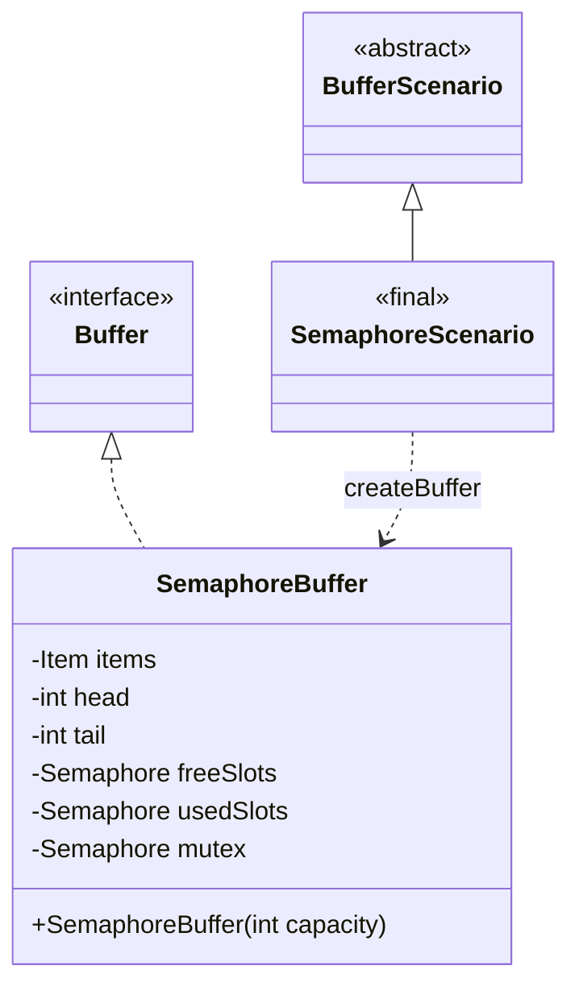

- `freeSlots = new Semaphore(capacity)`, `usedSlots = new Semaphore(0)`, `mutex = new Semaphore(1)`.
- `put`: controllo `null` e `acquire()` su `freeSlots` (interrompibile) → `mutex.acquire()` → scrittura in `tail` → `mutex.release()` → `usedSlots.release()`.
- `take`: speculare con `usedSlots`/`freeSlots`.
- Differenza didattica rispetto a `LockBuffer`: l'attesa è codificata nei contatori dei semafori, non in un `while` su una condizione.
- Passi: classe `SemaphoreBuffer`; `SemaphoreBufferTest extends SynchronizedBufferTest` (una sola riga di `createBuffer`); `SemaphoreScenario`; riga in `Scenarios.all()`; aggiornare `ScenariosTest`, `README.md`, `docs/GUIDE.md`, `docs/design.md`.
- Se `acquire()` lancia `InterruptedException` il permesso non è stato ottenuto: per quel permesso non va chiamato `release()`.

## 7. Tracciabilità FR/NFR → moduli

| Requisito | Moduli |
|---|---|
| FR-1 | `Scenarios`, `Tui` |
| FR-2 | `SequentialScenario` |
| FR-3 | `UnsafeBuffer`, `UnsafeScenario` |
| FR-4 | `MonitorBuffer`, `MonitorScenario` |
| FR-5 | `LockBuffer`, `LockScenario` |
| FR-6 | `BlockingQueueBuffer`, `BlockingQueueScenario` |
| FR-7 | `Parameters`, `SimulationConfig`, `Tui` |
| FR-8 | `Simulation`, `Producer`, `Consumer`, `Quota` |
| FR-9 | `Simulation`, `Consumer`, `Item` |
| FR-10 | `Simulation`, `Tui` |
| FR-11 | `SimulationResult`, `WorkerReport` |
| FR-12 | `ResultView`, `Tui` |
| FR-13 | `LiveView`, `SimulationListener`, `Tui` |
| FR-14 | `Producer`, `Consumer`, `SequentialScenario`, `UnsafeBuffer`, `UnsafeScenario` |
| FR-15, FR-16 | `Tui` |
| FR-17 | `SimulationListener` |
| NFR-1, NFR-10, NFR-11 | tutti i moduli (§3) |
| NFR-2, NFR-6 | `BufferTest`, `SynchronizedBufferTest`, `SimulationTest`, `pom.xml` |
| NFR-3 | package `model`, `counter`, `buffer`, `event`, `actor`, `simulation`, `scenario`, `tui` (§1.3) |
| NFR-4 | `Buffer`, `BufferScenario`, `Scenarios` (§6) |
| NFR-5 | `simulation`, `scenario`, `actor`, `buffer` (nessun I/O); `tui` (unico I/O) |
| NFR-7 | `pom.xml` |
| NFR-8, NFR-12 | `Theme`, `Box`, `Tui`, `App`, `ResultView`, `LiveView` |
| NFR-9 | `Simulation` |
