# BEHAVIOR — producer-consumer

> Progetto: producer-consumer · Data: 2026-11-23 · Versione: 1.0 · Stato: reviewed
> Documenti: [PRD](PRD.md) · [ARCHITECTURE](ARCHITECTURE.md) · [DESIGN-PATTERNS](DESIGN-PATTERNS.md) · [DESIGN-IN-THE-SMALL](DESIGN-IN-THE-SMALL.md) · [TEST-STRATEGY](TEST-STRATEGY.md) · [ANALYSIS](ANALYSIS.md) · [ADR](ADR/ADR-0001-stack.md) · [DESIGN-STATUS](DESIGN-STATUS.md)

Vista dinamica ricostruita dal codice: sequence diagram, state diagram e activity diagram.
La struttura statica (package, classi) è in [ARCHITECTURE](ARCHITECTURE.md).

Indice: §1 sequence di un run completo · §2 sequence della terminazione per timeout ·
§3 state diagram dei thread · §4 state diagram della `Simulation` · §5 state diagram delle schermate della TUI ·
§6 activity diagram di `put`/`take` per ciascun buffer · §7 activity diagram dello scenario sequenziale.

## 1. Sequence: run completo con vista dal vivo

Scenario di esempio: `MonitorScenario`, ritardo > 0, N producer, M consumer. TUI → Runner → Scenario →
Simulation → Producer/Consumer → Buffer → LiveView. Per brevità `Q` = `Quota` e `G` = `IdGenerator`.

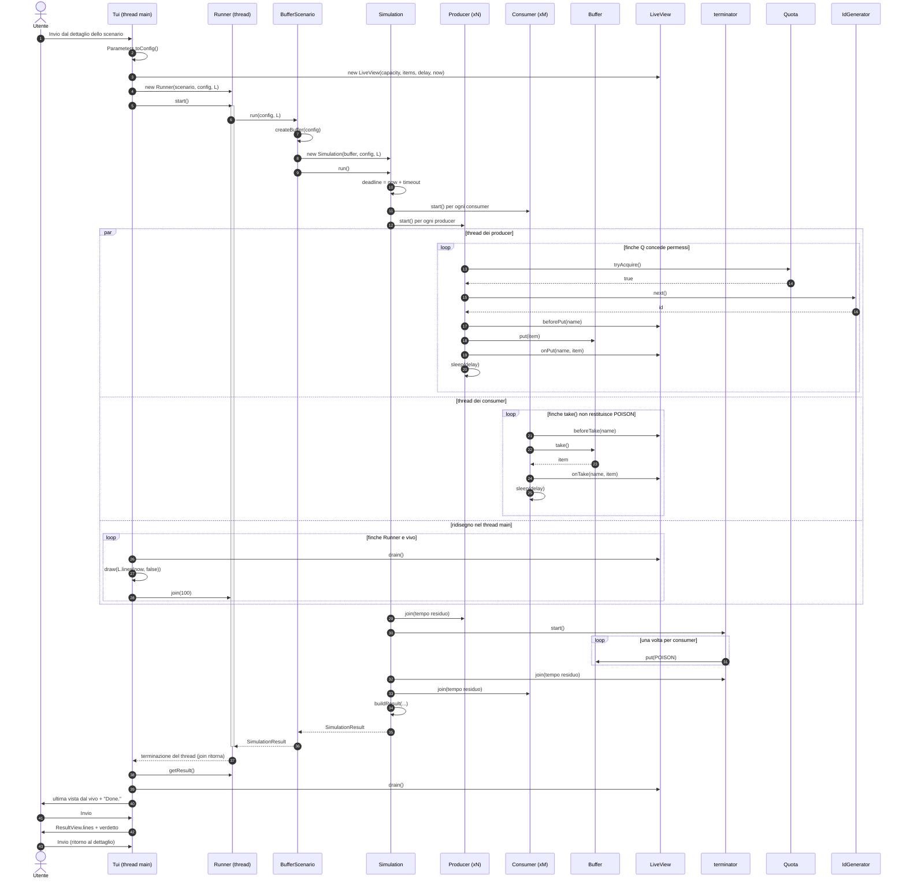

Note:

- I tre blocchi `par` sono concorrenti; i `put`/`take` sono sincronizzati dal `Buffer` scelto.
- Con ritardo 0 la TUI non passa `LiveView` (usa `SimulationListener.NONE`), non esegue `drain`/`draw` nel ciclo
  e mostra una sola riga "Running <scenario>...".
- Le pillole inserite da `X` non generano eventi; il consumer che le riceve ha emesso `beforeTake`.
- `Runner.result` è letto solo dopo che `isAlive()`/`join` hanno osservato la terminazione del thread: è ciò che garantisce la visibilità.

## 2. Sequence: terminazione per timeout

Scenario di esempio: `UnsafeScenario`, 2 consumer. Nel buffer non sincronizzato una pillola va persa
(aggiornamento perso di `count`): `consumer-2` resta in polling su `count <= 0` fino alla scadenza.

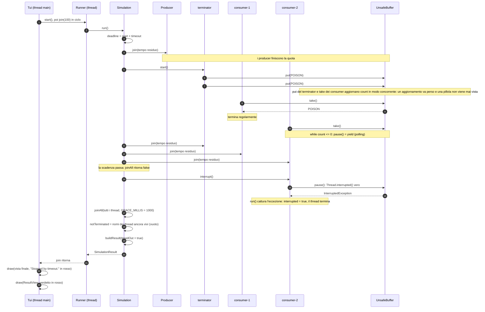

Se un thread ignora `interrupt()` resta vivo oltre il margine: finisce in `notTerminated` e la TUI mostra
"Still running: ..." in rosso. I thread sono daemon e non impediscono la chiusura della JVM
([ADR-0003](ADR/ADR-0003-timeout-scadenza-unica.md)). Il timeout può scattare in qualsiasi attesa del thread
chiamante (producer, terminator o consumer); se scatta prima dell'avvio del `terminator`, questo non parte mai.

## 3. State diagram dei thread `Producer` e `Consumer`

### 3.1 `Producer`

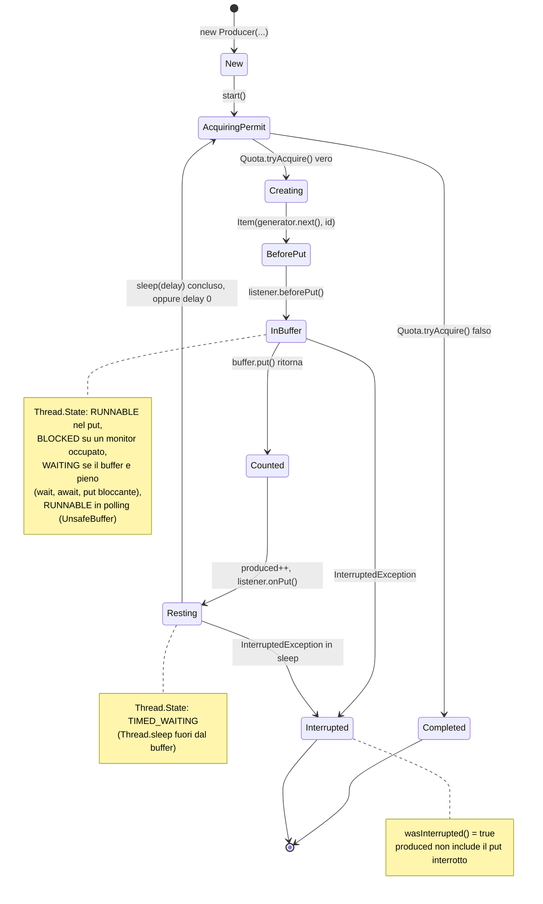

### 3.2 `Consumer`

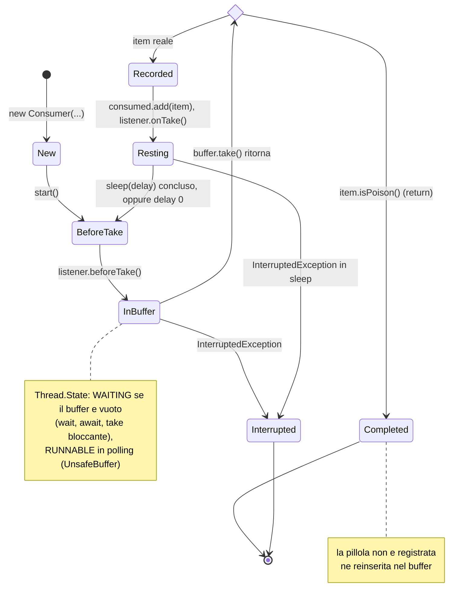

Entrambi i thread scrivono i propri campi (`produced`, `consumed`, `interrupted`) senza sincronizzazione:
la lettura avviene dopo `join()`/`isAlive() == false`, che stabilisce l'happens-before
([ADR-0010](ADR/ADR-0010-producer-quota.md), [ADR-0012](ADR/ADR-0012-consumer-registro-locale.md)).
Dopo un timeout con thread ancora vivi i valori possono non essere aggiornati (R-7).

## 4. State diagram della `Simulation`

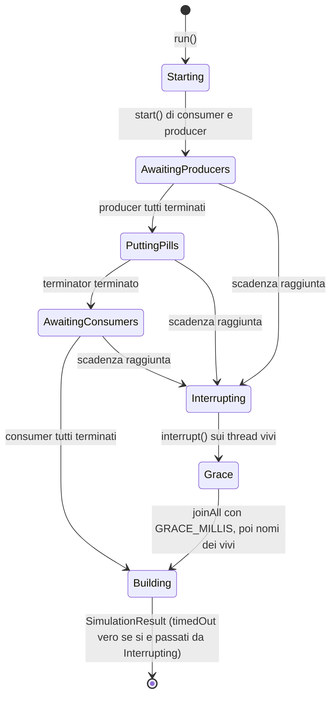

## 5. State diagram delle schermate della TUI

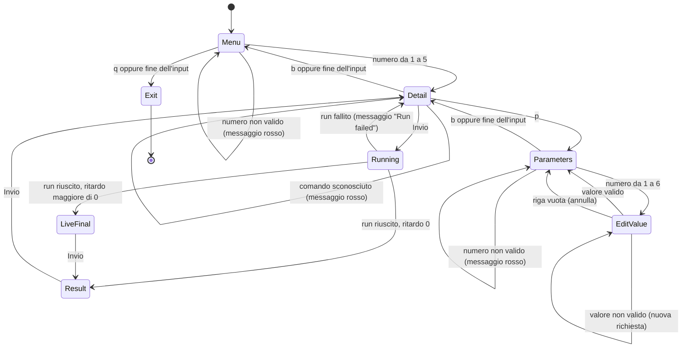

Dettagli:

- `Running` ridisegna ogni 100 ms con ritardo maggiore di 0; con ritardo 0 mostra una sola riga "Running <scenario>...".
- `LiveFinal` è l'ultima vista dal vivo con "Done." (verde) o "Stopped by timeout." (rosso).
- Ogni schermata attende una riga dall'utente; la fine dell'input equivale a "indietro".
- Il footer di `Running` indica "Ctrl+C quit": non esiste un comando per annullare un run (R-3).

## 6. Activity diagram di `put` e `take` per ciascun buffer

Legenda: i rombi sono decisioni; i nodi rosa nell'`UnsafeBuffer` sono le finestre della race
condition (lettura e scrittura non atomiche); `racePause` è `Thread.sleep(raceMillis)` se `raceMillis > 0`.

### 6.1 `UnsafeBuffer.put`

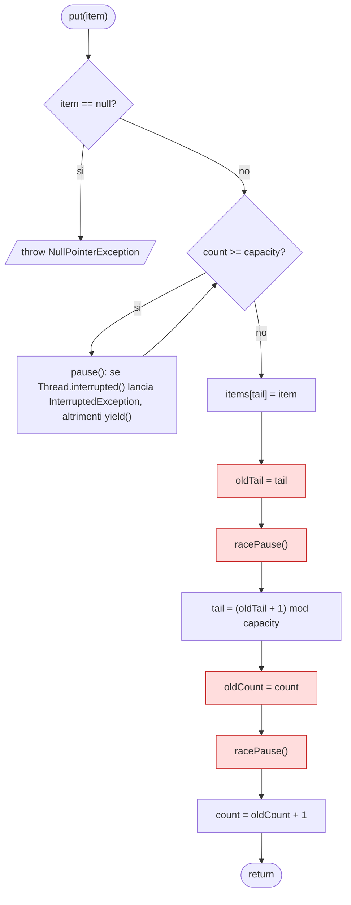

### 6.2 `UnsafeBuffer.take`

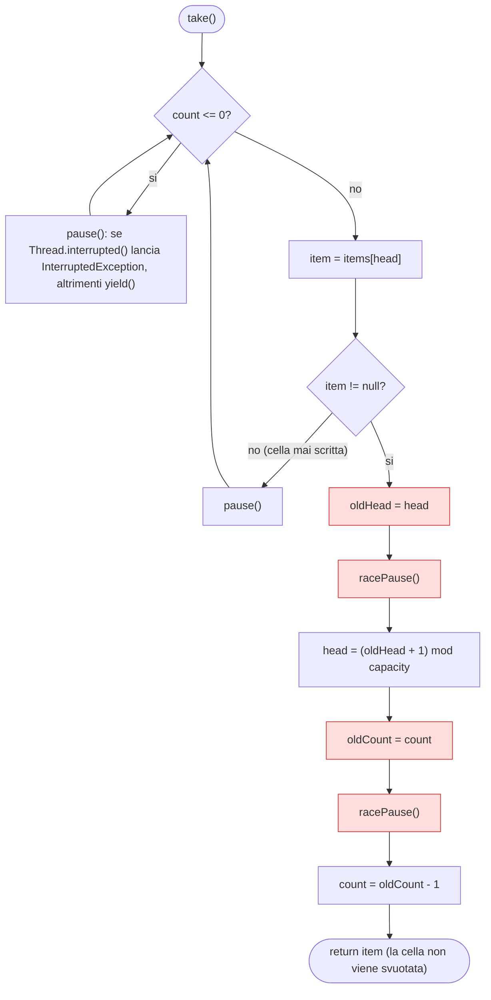

Effetti della race: due `put` che leggono lo stesso `tail` scrivono nella stessa cella (un item perso);
un `count` più alto del reale fa rileggere una cella già letta (duplicato); un `count` più basso lascia item non letti.

### 6.3 `MonitorBuffer.put`

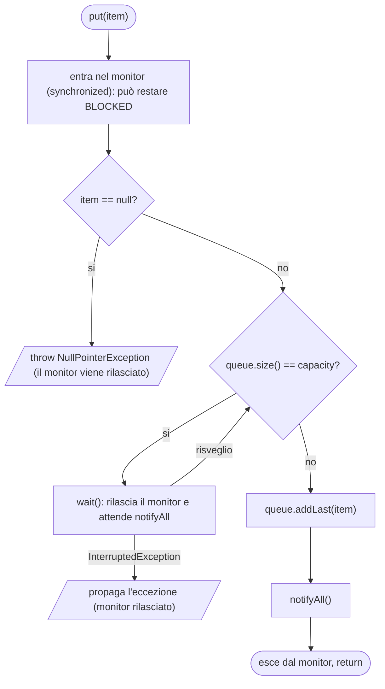

### 6.4 `MonitorBuffer.take`

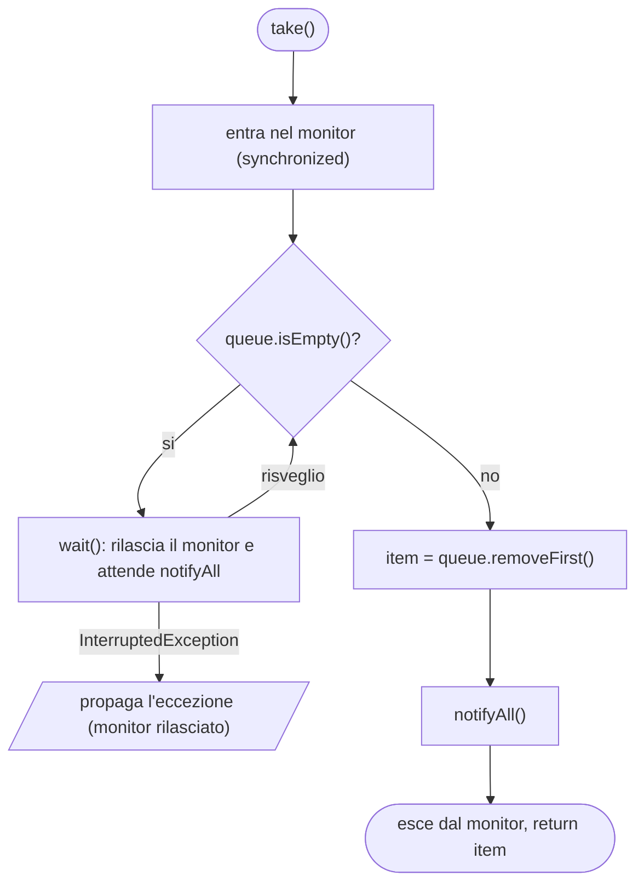

### 6.5 `LockBuffer.put`

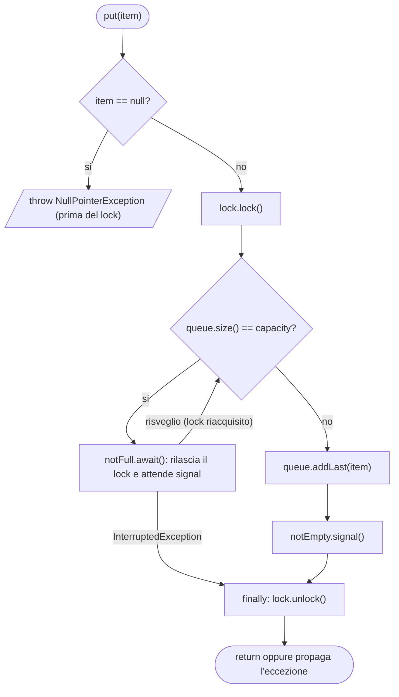

### 6.6 `LockBuffer.take`

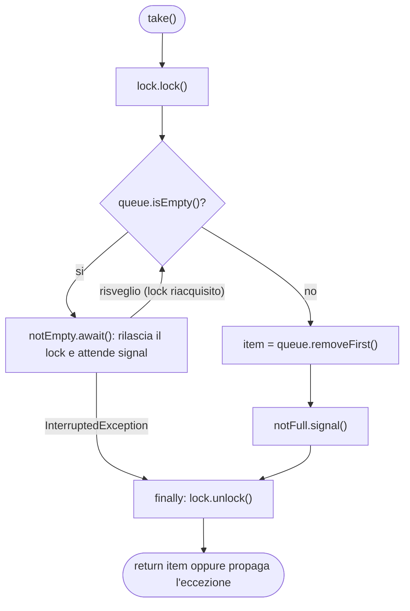

### 6.7 `BlockingQueueBuffer.put`

`BlockingQueueBuffer.put` inoltra a `ArrayBlockingQueue.put`. Il diagramma descrive il comportamento della
classe JDK (OpenJDK 21, schema equivalente a `LockBuffer`), non codice del progetto.

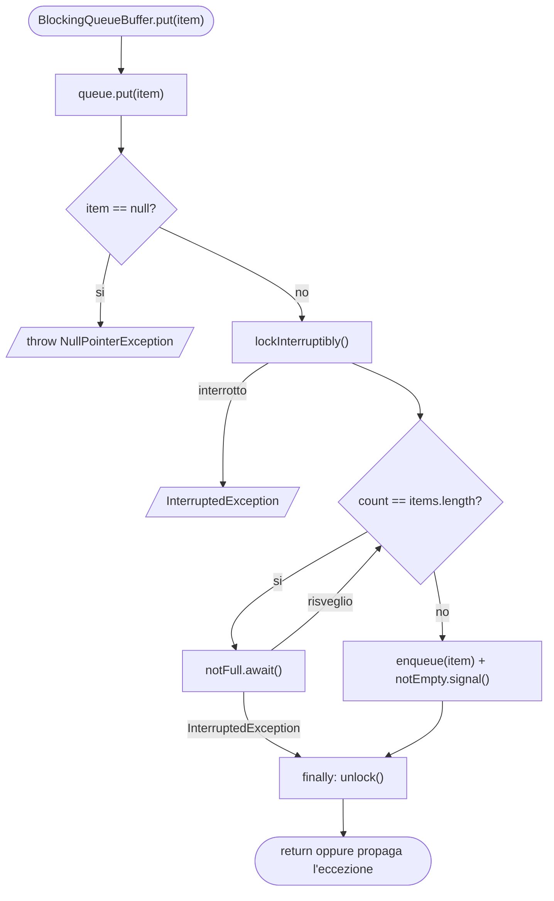

### 6.8 `BlockingQueueBuffer.take`

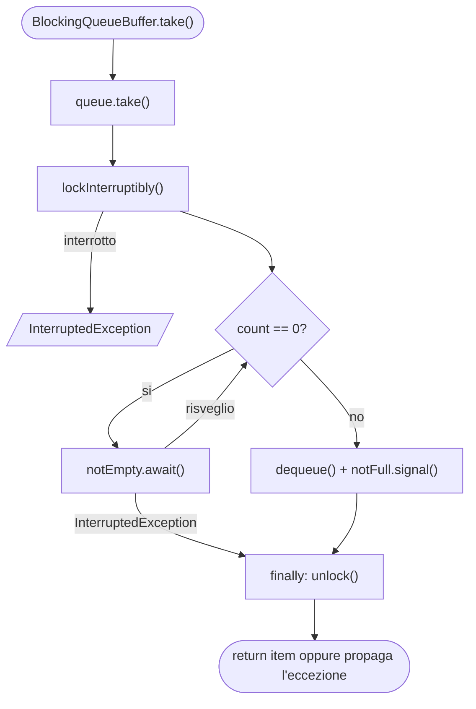

## 7. Activity diagram dello scenario sequenziale

`SequentialScenario.run` esegue tutto nel thread chiamante, con `UnsafeBuffer(capacity, 0)`.

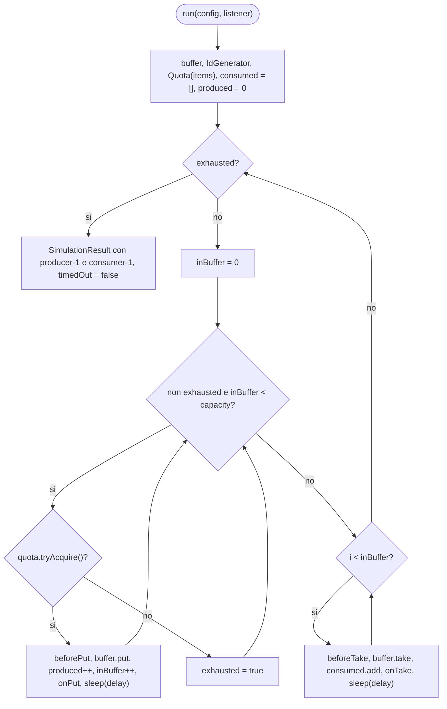
