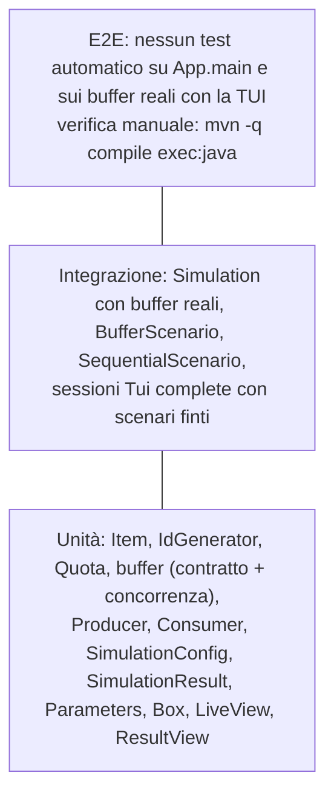

# TEST-STRATEGY — producer-consumer

> Progetto: producer-consumer · Data: 2026-11-23 · Versione: 1.0 · Stato: reviewed
> Documenti: [PRD](PRD.md) · [ARCHITECTURE](ARCHITECTURE.md) · [BEHAVIOR](BEHAVIOR.md) · [DESIGN-PATTERNS](DESIGN-PATTERNS.md) · [DESIGN-IN-THE-SMALL](DESIGN-IN-THE-SMALL.md) · [ANALYSIS](ANALYSIS.md) · [ADR](ADR/ADR-0001-stack.md) · [DESIGN-STATUS](DESIGN-STATUS.md)

Strategia di test **esistente**, ricostruita da `src/test/java` (JUnit 5.11.4, [ADR-0001](ADR/ADR-0001-stack.md)) e da
`docs/design.md` (D3 e sezione "Test dei buffer"). Esecuzione del 2026-11-23 con `mvn test`:
178 test, 0 falliti, 0 errori, 0 ignorati.

## 1. Principi

1. Ogni test concorrente ha un timeout: un blocco fa fallire il test, non la build ([ADR-0004](ADR/ADR-0004-test-deterministici.md)).
2. Si asseriscono invarianti vere in qualunque interleaving; mai l'ordine di esecuzione dei thread.
3. Un comportamento "si blocca" si verifica con `join(200)` + `isAlive()`, poi si sblocca con l'azione opposta.
4. Il difetto dell'`UnsafeBuffer` non è asserito (non deterministico): si verificano contratto a thread singolo e terminazione.
5. Le dipendenze temporali sono iniettate: `LiveView.lines(nowNanos, finished)` riceve l'istante corrente.
6. Il terminale è sostituito: `Tui(Reader, Writer, List<Scenario>)` con `StringReader`/`StringWriter`; l'output è normalizzato con `Ansi.strip`.
7. Stile classico anche nei test ([ADR-0017](ADR/ADR-0017-stile-codice-classico.md)): classi anonime al posto delle lambda, `try`/`fail`/`catch` al posto di `assertThrows` con lambda.

## 2. Piramide



| Livello | Classi di test | Cosa verificano |
|---|---|---|
| Unità | `ItemTest`, `IdGeneratorTest`, `QuotaTest`, `SimulationConfigTest`, `SimulationResultTest`, `ParametersTest`, `BoxTest`, `LiveViewTest`, `ResultViewTest`, `ProducerTest`, `ConsumerTest`, `ScenariosTest` | valori, validazioni, calcoli, formattazione; attori con buffer finti |
| Unità concorrenti | `BufferTest` (+ 5 sottoclassi), `SynchronizedBufferTest` (3 sottoclassi), `IdGeneratorTest`, `QuotaTest` | contratto del buffer; invarianti con più thread |
| Integrazione | `SimulationTest`, `BufferScenarioTest`, `SequentialScenarioTest`, `TuiTest` | `Simulation` con buffer reali e finti, scenari, sessioni TUI complete |
| E2E | nessuno (solo `SmokeTest`, placeholder) | vedi debito DT-2 |

## 3. Cosa si testa, per modulo

| Modulo | Unità | Integrazione | E2E |
|---|---|---|---|
| `model.Item` | uguaglianza per valore, getter, `POISON` riconosciuta (`ItemTest`) | — | — |
| `counter.IdGenerator` | parte da 0, consecutivo, generatori indipendenti; unicità con thread concorrenti (`IdGeneratorTest`) | — | — |
| `counter.Quota` | concede esattamente i permessi iniziali, resta esaurita, 0 permessi, negativo → `IllegalArgumentException`; totale esatto con 4 thread (`QuotaTest`) | — | — |
| `buffer.*` | contratto comune in `BufferTest`: FIFO, capacità, capacità non positiva, `null`, wrap-around, `take` attende se vuoto, `put` attende se pieno, interruzione di `take` e di `put` | — | — |
| `buffer` sicuri (Monitor, Lock, BlockingQueue) | `SynchronizedBufferTest`: 4 producer, 3 consumer, 5000 item ciascuno, ogni item consumato una volta | — | — |
| `buffer.UnsafeBuffer` | `UnsafeBufferTest` (`raceMillis` 0) e `UnsafeBufferRaceTest` (`raceMillis` 1) riusano il contratto a thread singolo; `raceMillis` negativo rifiutato | — | — |
| `actor.Producer` | un item per permesso, niente pillola, quota 0, quota condivisa tra producer, interruzione nel `put` e nella pausa, eventi `before`/`on`, pausa di `delay` (`ProducerTest`, buffer finti) | `SimulationTest` | — |
| `actor.Consumer` | consuma fino alla pillola, non registra la pillola, duplicati registrati, lista non modificabile, interruzione, eventi, pausa (`ConsumerTest`) | `SimulationTest` | — |
| `simulation.SimulationConfig` | valori, estremi accettati, estremi rifiutati per ciascun parametro, messaggio con nome e intervallo | — | — |
| `simulation.SimulationResult` | tutti consumati una volta, persi/duplicati, run vuoto, copie difensive, collezioni in sola lettura | — | — |
| `simulation.Simulation` | — | buffer sicuri: ogni item una volta; più consumer che producer; 0 item; unsafe termina (`notTerminated` vuoto); `StuckBuffer` → timeout entro `timeout + GRACE_MILLIS`; `IgnoresInterruptBuffer` → thread riportati; eventi contati; ritardo applicato |  |
| `scenario.BufferScenario` e sottoclassi | tipo di buffer creato, buffer nuovo a ogni run con la capacità configurata | scenari sicuri: ogni item una volta; riesecuzione; unsafe ritorna; listener inoltrato | — |
| `scenario.SequentialScenario` | un producer e un consumer nel risultato, quota multipla della capacità, 0 item | ordine riempimento/svuotamento degli eventi; pausa dopo ogni operazione | — |
| `scenario.Scenarios` | ordine del menu, nomi univoci e descrizioni non vuote, lista non modificabile | — | — |
| `tui.Box` | header, box con titolo e corpo riempito, riga di larghezza esatta, riga troppo larga rifiutata, titolo troncato, footer, `truncate`, `wrap`, `seconds` | — | — |
| `tui.Parameters` | valori predefiniti, limiti da `SimulationConfig`, `set`, `isLive`, rifiuto con valore precedente conservato, numero sconosciuto | — | — |
| `tui.LiveView` | eventi applicati solo con `drain`, conteggi, log limitato, "putting"→"waiting", "took #n"→"resting", "done", ordine dei thread, limite righe, barra limitata e scalata, ogni riga di 60 colonne | — | — |
| `tui.ResultView` | verdetto verde/rosso con tutte le cause, totali, limite righe e marcatura `*`, thread ancora vivi, duplicati ordinati e limitati | — | — |
| `tui.Tui` | — | sessioni complete con `FakeScenario` e `FailingScenario`: menu, uscita, scelta non valida, dettaglio, valore non valido richiesto di nuovo, annullamento, run senza ritardo (listener `NONE`), run con vista dal vivo, run fallito, comando sconosciuto, ogni riga entro la larghezza | verifica manuale |
| `tui.App`, `tui.Theme` (sequenze ANSI) | — | — | verifica manuale |

## 4. Edge case noti

| Caso | Dove è coperto |
|---|---|
| 0 item (nessun producer produce, i consumer devono comunque terminare) | `SimulationTest.zeroItemsTerminatesCleanly`, `SequentialScenarioTest.zeroItems`, `QuotaTest.zeroPermitsGrantsNothing` |
| Più consumer che producer (1 producer, 5 consumer) | `SimulationTest.worksWithMoreConsumersThanProducers` |
| Buffer capacità 1 e wrap-around | `BufferTest.reusesSlotsAfterWrapAround`, `putWaitsWhileFull` |
| Item totali multiplo della capacità (sequenziale) | `SequentialScenarioTest.handlesItemsMultipleOfCapacity` |
| Interruzione durante l'attesa nel buffer e durante la pausa | `BufferTest.interruptStops*`, `ProducerTest/ConsumerTest.stopsWhenInterruptedDuringPause` |
| Put interrotto non conteggiato e senza `onPut` | `ProducerTest.interruptedPutHasNoOnPutEvent` |
| Thread che ignora `interrupt()` | `SimulationTest.reportsThreadsThatIgnoreInterrupt` |
| Timeout con buffer bloccato | `SimulationTest.timeoutStopsBlockedThreads` |
| Poison pill persa dall'`UnsafeBuffer` | non asseribile; coperto indirettamente da `unsafeBufferAlwaysReturns` (il run termina) |
| Valori ai limiti (`MIN_*`/`MAX_*`) | `SimulationConfigTest.accepts*Bounds`, `rejects*OutOfRange` |
| Larghezza della TUI con 50+50 thread, migliaia di duplicati | `ResultViewTest`, `LiveViewTest.limitsThreadRows` |
| Riga più larga di 56 colonne | `BoxTest.boxRejectsLineTooLong` |
| Non coperti | `Item(-1,-1)` costruito a mano (R-8); `Runner` con `Error` (R-12); `Simulation.run` interrotta dal chiamante (R-5); `truncate` con `width < 3`; `LiveView` con capacità 0 |

## 5. Come si scrive il primo test (TDD) per un'estensione

Esempio: nuovo `SemaphoreBuffer` (E-1 in [ARCHITECTURE](ARCHITECTURE.md) §6.1).

1. Creare `src/test/java/producerconsumer/buffer/SemaphoreBufferTest.java` che estende `SynchronizedBufferTest` e dichiara solo la creazione:

```java
package producerconsumer.buffer;

class SemaphoreBufferTest extends SynchronizedBufferTest {

    @Override
    protected Buffer createBuffer(int capacity) {
        return new SemaphoreBuffer(capacity);
    }
}
```

2. `mvn -Dtest=SemaphoreBufferTest test`: fallisce in compilazione (la classe non esiste), poi con lo scheletro che lancia
   `UnsupportedOperationException` fallisce ogni test ereditato (rosso).
3. Implementare un test alla volta, nell'ordine: `rejectsNonPositiveCapacity` → `exposesCapacity` → `returnsItemsInFifoOrder` →
   `rejectsNullItem` → `reusesSlotsAfterWrapAround` → `takeWaitsWhileEmpty` → `putWaitsWhileFull` → `interruptStops*` →
   `everyItemIsConsumedExactlyOnce`.
4. Scenario: `SemaphoreScenario` + aggiornare `ScenariosTest`; opzionale: caso in `BufferScenarioTest` (parametri `ValueSource`) e `SimulationTest`.

Per una nuova classe del nucleo senza dipendenze concorrenti il primo test è un test di valore (es. `ItemTest`):
costruire l'oggetto, asserire i getter, poi i casi limite.

## 6. Determinismo e riproducibilità

| Aspetto | Come è garantito oggi | Lacuna |
|---|---|---|
| Versioni | JUnit 5.11.4, surefire 3.5.2, compiler-plugin 3.13.0 pinnati nel `pom.xml`; `release=21` | JDK non pinnato oltre `release` (DT-1); nessun `mvnw` |
| Ordine dei thread | non asserito; solo invarianti | — |
| Seed casuali | non servono: il codice non usa numeri casuali | — |
| Fixture | nessuna persistente; ogni test crea buffer e thread propri | — |
| Attese | `@Timeout` di classe (5, 10 o 15 s) + `join` con limite; `CountDownLatch` per sincronizzare i test sul primo evento | `join(200)` seguito da `assertFalse(isAlive())` entro 2 s dipende dalla velocità della macchina (R-10) |
| Tempo | `LiveView` riceve `nowNanos`; i test di pausa usano solo limiti inferiori (`elapsed >= N`) | `timeoutStopsBlockedThreads` asserisce un limite superiore (`< 200 + GRACE_MILLIS` ms): sensibile a macchine sotto carico (R-10) |
| Terminale | `Reader`/`Writer` iniettati; `Ansi.strip`; larghezza fissa | i colori dipendono dal supporto truecolor del terminale (R-9) |
| Ambiente isolato | nessun container, nessun file esterno, nessuna rete | versione del JDK vincolata solo da `release=21`, senza Maven wrapper (DT-1) |
| Scenario non sincronizzato | test sul solo contratto e sulla terminazione | il difetto è dimostrabile solo a mano |

Comandi:

```bash
mvn test                              # intera suite
mvn -Dtest=SimulationTest test        # una classe
mvn -q compile exec:java              # esecuzione manuale (e2e)
```

## 7. Regole per i nuovi test

- Estendere `BufferTest`/`SynchronizedBufferTest` per ogni nuovo buffer; non duplicare il contratto.
- `@Timeout` su ogni classe con thread; nessun `Thread.sleep` come sincronizzazione: usare `join` con limite o `CountDownLatch`.
- Asserire proprietà (totali, unicità), non ordinamenti tra thread diversi.
- Buffer e listener finti nel test (`StuckBuffer`, `RecordingListener`) quando serve controllare il comportamento.
- Rispettare lo stile classico (classi anonime, niente lambda).
